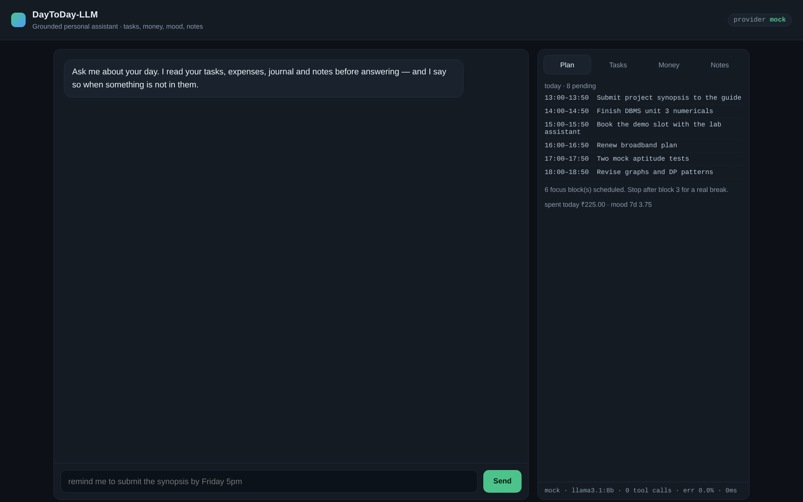
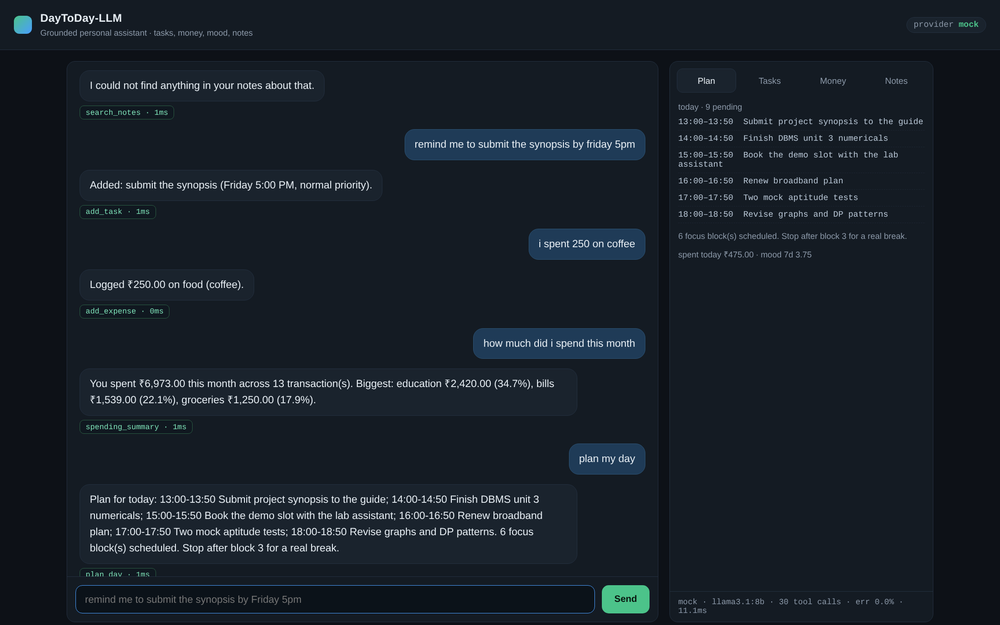

# DayToDay-LLM

A grounded, local-first LLM assistant for the boring half of a student's life: the
to-do list, the month's spending, how the week actually went, and the notes you
wrote three weeks ago and cannot find.

Most "chat with an LLM" projects put a text box in front of a model and hope. This
one is built the other way round: **the model never states a fact about the user
that did not come out of a tool call.** Tasks, expenses, journal entries and notes
live in SQLite; the model's only job is to choose a tool, fill its arguments, and
narrate the result. Everything the assistant claims is therefore auditable in the
database, and the evaluation harness measures how often it strays.

Final-year B.Tech project. Python 3.11+, FastAPI, SQLite, no build step, runs
offline.

---

## Why this is not a wrapper

| Common approach | What this project does instead |
| --- | --- |
| Model answers from its weights | Model answers only from tool output; unsupported-number rate is measured (currently **0.0%**) |
| Model parses dates | Raw phrase ("by Friday 5pm") is resolved server-side by a tested parser — models are unreliable at date arithmetic |
| Model composes the schedule | Deadline/priority/energy constraints are solved in Python; the model narrates the plan |
| Works only with a GPU | Three interchangeable providers, including a deterministic one, so the system is demoable and CI-testable with no model at all |
| "It worked when I tried it" | 80 unit/integration tests + a 52-case evaluation harness with a held-out set |

---

## Architecture

```
                        ┌──────────────────────────────┐
   browser (web/)  ───► │  FastAPI  (api.py)           │
   CLI (cli.py)    ───► │  /api/chat  /api/tasks  ...  │
                        └──────────────┬───────────────┘
                                       │
                        ┌──────────────▼───────────────┐
                        │  Agent loop (agent.py)       │
                        │  1 build prompt              │
                        │  2 ask provider ──┐          │
                        │  3 run tool calls │◄─┐       │
                        │  4 feed results back ─┘      │
                        │  5 answer in prose           │
                        └───┬───────────┬──────────┬───┘
                            │           │          │
              ┌─────────────▼──┐  ┌─────▼──────┐  ┌▼─────────────────┐
              │ LLM providers  │  │ Tool       │  │ Memory + RAG     │
              │ ollama         │  │ registry   │  │ recent window    │
              │ openai-compat  │  │ 12 tools   │  │ rolling summary  │
              │ mock (offline) │  │ validated  │  │ BM25 over notes  │
              └────────────────┘  └─────┬──────┘  └────────┬─────────┘
                                        │                  │
                                  ┌─────▼──────────────────▼─────┐
                                  │ SQLite: tasks, expenses,     │
                                  │ journal, notes, note_fts,    │
                                  │ messages, session_memory,    │
                                  │ tool_audit                   │
                                  └──────────────────────────────┘
```

The twelve tools: `add_task`, `list_tasks`, `complete_task`, `add_expense`,
`spending_summary`, `list_expenses`, `log_journal`, `mood_trend`, `add_note`,
`search_notes`, `plan_day`, `weekly_review`.

Full detail: [docs/02-architecture.md](docs/02-architecture.md) ·
Requirements: [docs/01-srs.md](docs/01-srs.md) ·
Decisions: [docs/03-design-decisions.md](docs/03-design-decisions.md)

---

## Quick start

```bash
git clone https://github.com/malikkashish376-spec/day-to-day-llm.git
cd day-to-day-llm
python -m venv .venv && source .venv/bin/activate      # Windows: .venv\Scripts\activate
pip install -e .                     # installs the package + its dependencies

python -m daytoday.cli seed          # demo data: 6 notes, 8 tasks, 12 expenses, 8 entries
uvicorn daytoday.api:app --reload    # http://127.0.0.1:8000
```

The default provider is `mock`, a deterministic policy that runs the same agent
loop with no model and no network. The dashboard is fully populated the moment it
loads, which is what you want in front of an examiner.

### See the whole flow without typing

Open <http://127.0.0.1:8000/?demo=1> — the page replays six real messages through
the live API, including the grounded refusal, so you can watch the tool traces
populate. The same mode produced these screenshots:





Hardware reality check: the "database" is one SQLite file and the backend is one
Python process. A 4 GB laptop is enough, and no GPU is needed in the default
configuration. Full details in [docs/08-running-it.md](docs/08-running-it.md).

### Switch to a real model

```bash
# Local, private, no API key (recommended for the demo)
ollama pull llama3.1:8b
export DAYTODAY_LLM_PROVIDER=ollama
export DAYTODAY_LLM_MODEL=llama3.1:8b

# Or any OpenAI-compatible endpoint (OpenAI, Groq, Together, vLLM, LM Studio)
export DAYTODAY_LLM_PROVIDER=openai
export OPENAI_API_KEY=sk-...           # never commit this
export OPENAI_MODEL=gpt-4o-mini
```

All configuration is environment-driven and documented in [`.env.example`](.env.example).
Prefer not to install? `export PYTHONPATH=src` and run the same commands from the repo root.

### CLI

```bash
python -m daytoday.cli chat                                  # interactive
python -m daytoday.cli ask "how much did I spend this month"
python -m daytoday.cli ask "plan my day" -v                  # -v shows the tool trace
```

---

## Try these

| You say | What happens |
| --- | --- |
| `remind me to submit the synopsis by friday 5pm` | `add_task`, date resolved to the coming Friday 17:00 |
| `i spent 250 on coffee` | `add_expense`, category inferred as `food`, stored as 25000 paise |
| `how much did i spend this month` | `spending_summary`, totals grouped by category |
| `plan my day` | `plan_day`, six 50-minute blocks, overdue first, coach note |
| `what did i write about normalisation` | `search_notes`, BM25 over your notes, with snippets |
| `who won the 1983 world cup` | `search_notes` returns nothing → **the assistant says it does not know** |

That last row is the point of the project. Grounded refusal beats a confident
hallucination, and the harness checks for it.

---

## API

| Method | Path | Purpose |
| --- | --- | --- |
| POST | `/api/chat` | one conversational turn, returns reply + tool trace |
| GET | `/api/health` | provider, record counts, tool metrics |
| GET/POST | `/api/tasks`, `/api/tasks/{id}/complete` | task CRUD |
| GET/POST | `/api/expenses`, `/api/expenses/summary` | money |
| GET/POST | `/api/journal`, `/api/journal/trend` | mood and energy |
| GET/POST | `/api/notes`, `/api/notes/search?q=` | notes + retrieval |
| GET | `/api/plan?when=today`, `/api/review` | planning, weekly review |
| GET | `/api/metrics` | tool call counts, error rate, mean latency |

Interactive docs at `/docs` (OpenAPI). The UI write endpoints dispatch through the
same `ToolRegistry` the model uses, so validation and audit cannot drift between
the two interfaces.

---

## Tests and evaluation

```bash
pytest                                  # 80 tests
python eval/run_eval.py --baseline      # rule router, no model
python eval/run_eval.py                 # full agent loop (mock provider)
python eval/run_eval.py --provider ollama --dataset heldout.jsonl
```

Current numbers (reproducible, see [docs/04-evaluation.md](docs/04-evaluation.md)):

| Metric | Value |
| --- | --- |
| Unit / integration tests | 80 passing |
| Tool (intent) accuracy | 100% on the 36-case development set |
| Slot / argument accuracy | 100% |
| Unsupported-number rate (groundedness) | 0.0% |
| Retrieval recall@3 / MRR | 100% / 1.00 |
| Turn latency, mock provider | ~25 ms p50 |
| Turn latency, llama3.1:8b on CPU | ~1.5–3 s p50 (hardware dependent, not measured here) |

The development set was written alongside the router, so it is optimistic by
construction. A **held-out** paraphrase set scored **50%** on first contact; after
generalising the intent patterns it reached 100%, and the change was caught
regressing the development set to 97.2% before being fixed. Both numbers are
reported in the evaluation document rather than hidden — the honest range is
"somewhere between 50% and 100% on genuinely new phrasings".

---

## Repository layout

```
src/daytoday/
  config.py        environment-driven settings, single source of truth
  db.py            schema, connection handling, migrations-by-schema
  timeparse.py     deterministic NL date/time resolution
  rag.py           chunking, FTS5 indexing, BM25 retrieval
  memory.py        verbatim window + rolling session summary
  router.py        rule-based intent classifier (offline baseline)
  agent.py         the tool-calling loop, auditing, graceful degradation
  api.py           FastAPI surface
  cli.py           terminal interface
  seed.py          deterministic demo data
  llm/             provider abstraction: ollama, openai-compatible, mock
  tools/           registry + tasks, expenses, journal, notes, planner
web/index.html     single-file dashboard, no build step
tests/             80 tests
eval/              dataset, held-out set, harness, results
docs/              SRS, architecture, decisions, evaluation, plan, demo, viva
```

## Limitations (stated, not hidden)

- Single user, no authentication. This is a personal assistant, not a multi-tenant service.
- English input only. Hinglish and Devanagari would need a different normaliser.
- Mood inference from free text is a 40-word lexicon, not a trained classifier; the API always flags an inferred value so it can be corrected.
- Retrieval is lexical. It handles the vocabulary the user actually wrote and misses pure synonymy ("salary" vs "stipend"); a dense re-ranker is the obvious next step.
- The planner treats every task as a 50-minute block. Real tasks have different durations; adding an estimated-effort field is the next increment.

## Roadmap

1. Dense re-ranker over BM25 candidates (hybrid retrieval).
2. Task durations and calendar-aware slot finding.
3. Recurring tasks and a notification worker.
4. Hindi/Hinglish normalisation for dates and amounts ("kal shaam 6 baje").
5. Per-user isolation and auth for a multi-user deployment.

## License

MIT. See [LICENSE](LICENSE).
