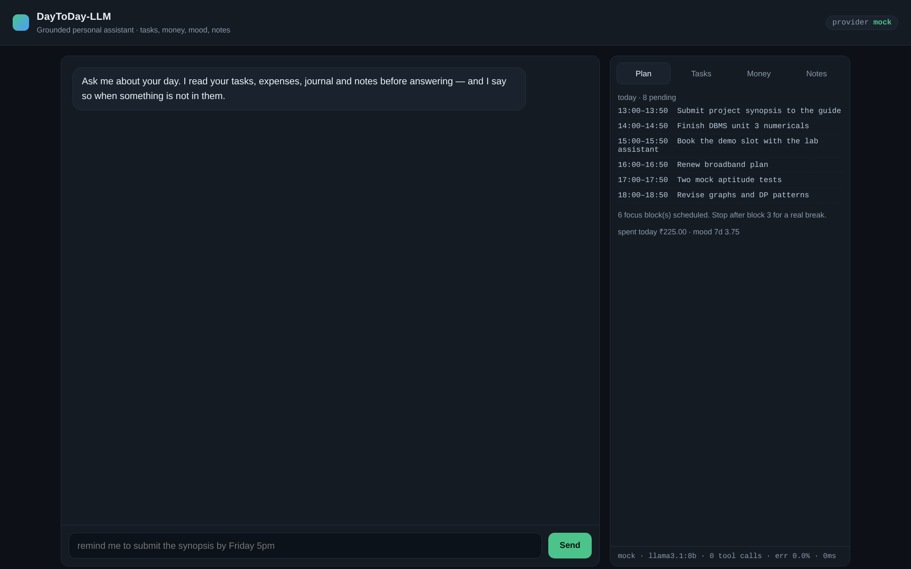

# Running it: what you actually need

**Short version: a laptop. Nothing else.** There is no high-end database and no
server infrastructure in this project. The "database" is a single SQLite file
(`data/daytoday.db`, a few hundred kilobytes) that Python ships with, and the
backend is one Python process serving both the API and the web page. It runs
comfortably on a 4 GB machine from 2015.

| What people assume | What this project uses |
| --- | --- |
| PostgreSQL / MySQL server to install and administer | SQLite, embedded, one file, zero setup |
| Vector database for retrieval | SQLite FTS5, built into Python's `sqlite3` |
| GPU for the language model | Not required — default provider is deterministic and offline |
| Cloud hosting to demo | `localhost:8000` on your own machine |
| Docker or Kubernetes | Optional convenience, not required |

If you want a *real* LLM answering (rather than the deterministic provider), that
is the only thing with a hardware cost — see §4. Even then, a 3B–8B model runs on a
CPU at a few seconds per turn.

---

## 1. The two-minute path (recommended)

Requires Python 3.11 or newer (`python --version`).

```bash
git clone https://github.com/malikkashish376-spec/day-to-day-llm.git
cd day-to-day-llm

python -m venv .venv
source .venv/bin/activate          # Windows: .venv\Scripts\activate
pip install -e .

python -m daytoday.cli seed        # loads demo tasks, expenses, journal, notes
uvicorn daytoday.api:app --reload  # then open http://127.0.0.1:8000
```

Open <http://127.0.0.1:8000> and type:

> remind me to submit the synopsis by friday 5pm

You should see the reply, a green `add_task · 2ms` chip under it (click it for the
raw tool call), and the task appear in the right-hand Tasks pane.

### Windows, without activating a venv

```bat
py -m pip install -e .
py -m daytoday.cli seed
py -m uvicorn daytoday.api:app --reload
```

`make` targets do not work on Windows; the four commands above are all of them.

## 2. See the whole flow without typing

Open <http://127.0.0.1:8000/?demo=1>. The page replays six real messages through
the live API — including the grounded refusal ("who won the 1983 world cup") — and
you can watch the tool traces populate. This is the same mode used to produce the
screenshots in this folder.



## 3. Docker path (no Python on the host)

```bash
docker compose up --build
```

Then <http://127.0.0.1:8000>. The SQLite file lives in `./data` on the host, so your
data survives container restarts.

## 4. With a real language model

The default provider (`mock`) is deterministic: it classifies your message with the
rule router and renders an answer from real database rows. It exercises the whole
system — tools, validation, retrieval, memory, audit — with no model at all. That is
why the demo cannot fail because of a download.

To put a real model behind the same tools, install [Ollama](https://ollama.com) and:

```bash
ollama pull llama3.1:8b            # ~4.7 GB; a 3B model is enough on 8 GB RAM
export DAYTODAY_LLM_PROVIDER=ollama       # Windows: set DAYTODAY_LLM_PROVIDER=ollama
uvicorn daytoday.api:app
```

Or point it at any hosted OpenAI-compatible endpoint (OpenAI, Groq, Together):

```bash
export DAYTODAY_LLM_PROVIDER=openai
export OPENAI_API_KEY=sk-...               # never commit this
export OPENAI_MODEL=gpt-4o-mini
```

The dashboard header shows which provider is live. Nothing else changes — same
tools, same database, same UI.

## 5. Command line only (no browser)

```bash
python -m daytoday.cli chat                        # interactive
python -m daytoday.cli ask "plan my day"
python -m daytoday.cli ask "how much did i spend this month" -v   # -v shows the trace
bash scripts/demo.sh                               # scripted seven-message tour
```

## 6. Checking it is healthy

| Endpoint | What it tells you |
| --- | --- |
| `/api/health` | provider, record counts, tool metrics |
| `/api/metrics` | tool calls, error rate, mean latency, per-tool breakdown |
| `/docs` | interactive OpenAPI page — every endpoint, callable from the browser |

## 7. Showing it to someone else

- **On the college LAN** — run `uvicorn daytoday.api:app --host 0.0.0.0 --port 8000`
  and share `http://<your-ip>:8000`. Note there is no authentication, so only do
  this on a trusted network.
- **On a free host** — Render, Railway or Fly.io can run the Dockerfile as-is.
  Caveat: most free tiers have an ephemeral filesystem, so the SQLite file resets on
  redeploy. Attach a persistent volume, or accept a fresh demo database each deploy.
  Hugging Face Spaces (Docker SDK) works the same way.
- **In the viva** — run locally. No network dependency, no cold start, no API bill.

## 8. Troubleshooting

| Symptom | Cause and fix |
| --- | --- |
| `ModuleNotFoundError: daytoday` | `pip install -e .` was skipped; or run with `PYTHONPATH=src` |
| `uvicorn: command not found` | Use `python -m uvicorn daytoday.api:app` |
| Dashboard loads, panes are empty | No seed data: `python -m daytoday.cli seed` |
| `provider mock` in the header | Expected default; see §4 to switch |
| `degraded` chip on a reply | The configured provider was unreachable; the turn was served by the offline provider |
| `sqlite3.OperationalError: no such table` | Database not initialised: `python -m daytoday.cli init` |
| Port 8000 busy | `uvicorn daytoday.api:app --port 8080` |
| `database is locked` | Two writers; close the CLI session that is holding the file |
